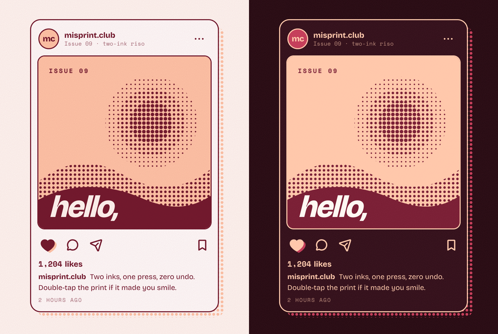

# Like Button

A like button printed in two risograph inks. Tap the heart and both inks flood in from the bottom, the peach one snaps (almost) into register, halftone dots burst out and the count rolls like an odometer. Tap again and the ink drains away. Double-tap the print for a big stamped heart.



**[Live demo](https://arslanagayev.github.io/like-button-animation/)** · **[Reel mode](https://arslanagayev.github.io/like-button-animation/?reel)** · UI animation #09 of a weekly series on Instagram [@arslanagayev.dev](https://www.instagram.com/arslanagayev.dev/)

Plain **HTML, CSS and JavaScript**: no frameworks, no build step, no runtime dependencies.

## How it works

1. **Ink flood.** The filled heart is drawn twice, once per ink, and hidden with `clip-path: inset(100% 0 0 0)`. Liking animates the clip to `inset(0)`, so the colour rises from the bottom. Unliking runs it the other way and the ink drains.
2. **Off register.** The peach copy sits a few pixels off, like a real riso print. On a like it starts far off and springs back to its usual offset.
3. **Halftone burst.** Twelve dots in alternating inks fly out on a ring. Each one is a single Web Animations API call that removes itself when it finishes.
4. **Odometer.** The count is split into digits and only the digits that change roll: up for a like, down for an unlike.
5. **Double tap.** `dblclick` with a mouse, two quick taps on touch. The stamp lands blurred and oversized, then sharpens like ink hitting paper, and the post is liked if it wasn't already.

## The key code

```js
// Both inks flood the heart from the bottom, and the peach one snaps into register.
for (const layer of inks) {
  layer.animate(
    { clipPath: ['inset(100% 0 0 0)', 'inset(0 0 0 0)'] },
    { duration: 340, delay: 60, fill: 'backwards' },
  );
}
offRegister.animate({ translate: ['13px -9px', '4px 3px'] }, { duration: 560, delay: 60, fill: 'backwards' });
```

## Features

- Two-ink riso look in Bridal and Skin Tone: paper grain from an SVG `feTurbulence` filter, halftone dot patterns, a halftone "shadow" and misregistered layers
- The artwork is an inline SVG built from dot patterns, no images
- Light and dark themes from `prefers-color-scheme`
- `prefers-reduced-motion`: no burst, stamp or roll, the state just changes
- A real `<button>` with `aria-pressed`, visible focus rings, 44px+ touch targets and an `aria-live` status ("Liked. 1,204 likes")
- Bricolage Grotesque and Space Mono, self-hosted (`assets/fonts`, SIL Open Font License); icons from [Phosphor](https://phosphoricons.com) (MIT), inlined as SVG
- misprint.club is a fictional zine made for this demo

## Use it in your project

Copy `index.html`, `style.css`, `script.js`, `reel/theme.css` (colour tokens, fonts and grain) and `assets/`. The `reel/` scripts only power the reel mode below; to drop them, delete the `mountReel(...)` call at the end of `script.js` and the `isAutoplay` import and check.

## Reel mode

Add `?reel` to the URL and the page becomes a self-playing 1080×1920 stage with a title, a scripted cursor, a code excerpt (left out when the demo needs the room) and an end card. `?autoplay` loops the scripted demo without the frame. Options: `&ratio=4x5`, `&nocode`, `&delay=3000`.

## Run locally

ES modules don't load from `file://`, so serve the folder:

```bash
git clone https://github.com/arslanagayev/like-button-animation.git
cd like-button-animation
python3 -m http.server 8000
```

Then open <http://localhost:8000>.

## License

[MIT](LICENSE) for the code. Bricolage Grotesque and Space Mono are under the SIL Open Font License ([assets/fonts/LICENSE-OFL.txt](assets/fonts/LICENSE-OFL.txt)).
